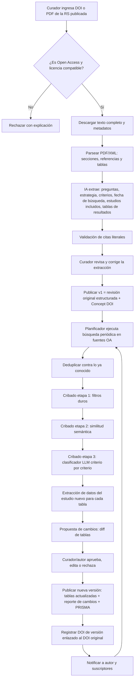
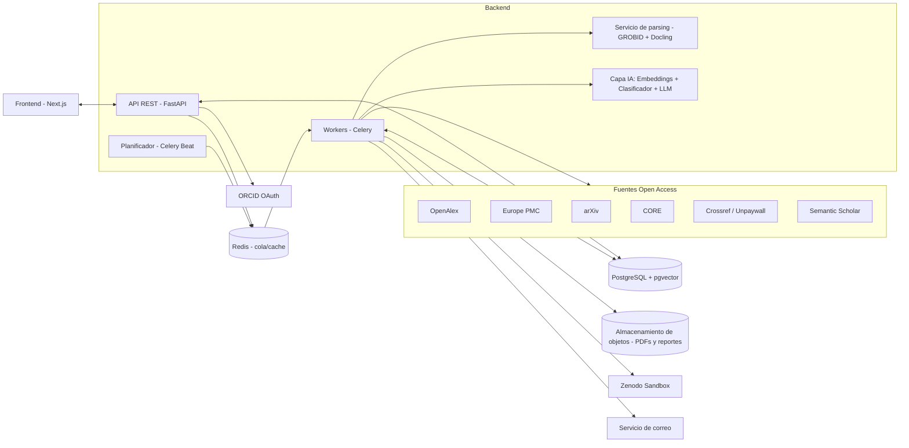

# PLAN MAESTRO DE DESARROLLO — LiveSRL
### Plataforma web de Revisiones Sistemáticas de Literatura Vivas (Living Systematic Reviews) sobre fuentes Open Access

> **Documento para entregar a una IA de desarrollo.** Contiene todo lo necesario para construir la aplicación de inicio a fin: visión, requisitos, arquitectura, modelo de datos, pipeline de IA, API, pantallas, DOI, notificaciones, pruebas, despliegue y plan por fases.
> Fuentes: el plan de trabajo de integración curricular (UTN, Carrera de Software) y las indicaciones de la reunión con tutor y asesor.

---

## 0. INSTRUCCIONES PARA LA IA QUE CONSTRUIRÁ LA APP

Actúa como un equipo senior (arquitecto de software, ingeniero backend, ingeniero de ML/NLP, ingeniero frontend y QA). Reglas de trabajo:

1. **Construye por fases** (sección 20). No pases a la siguiente sin que la anterior funcione de punta a punta y tenga pruebas.
2. **Nada de datos simulados en la versión final.** Los mocks solo se permiten en pruebas automáticas.
3. **Todo lo que la IA extraiga de un artículo debe tener evidencia**: cita literal + ubicación (página/sección/tabla). Si no hay evidencia, el campo queda vacío y marcado "no encontrado". Nunca inventes datos.
4. **La IA no interpreta ni opina.** Solo extrae, clasifica, actualiza tablas y documenta cambios. No redacta discusión ni conclusiones científicas.
5. **El humano decide.** La IA propone; un curador/autor aprueba antes de publicar una nueva versión (configurable, ver RF-08).
6. **Proveedores intercambiables**: el LLM, el modelo de embeddings y el proveedor de DOI se acceden mediante interfaces/adaptadores. Cambiar de proveedor = cambiar configuración, no código.
7. Código limpio, tipado, documentado, con pruebas, migraciones de base de datos, variables de entorno en `.env.example`, y un `README.md` que permita levantar todo con un solo comando (`docker compose up`).
8. Si una decisión no está especificada aquí, elige la opción más simple, estándar y mantenible, y regístrala en `docs/DECISIONES.md`.
9. Verifica en la documentación oficial las versiones vigentes de cada librería/API antes de usarlas.
10. **La usabilidad es un requisito, no un adorno.** Cumple la sección 16.0 al pie de la letra. Ante la duda entre "mostrar más opciones" y "pantalla más simple", elige siempre la más simple.

---

## 1. VISIÓN DEL PRODUCTO

**Nombre de trabajo:** LiveSRL (dominio de ejemplo: `livesrl.com`; en esta etapa funciona en **modo prueba**, no en producción).

**Problema:** una revisión sistemática (RS) publicada queda desactualizada en meses. Actualizarla exige repetir búsquedas y cribado manual, y escribir otro artículo completo.

**Solución:** una aplicación web que:
1. Recibe una **RS ya publicada y Open Access** (ej.: publicada en Taylor & Francis en acceso abierto) mediante su DOI o PDF.
2. Con IA **extrae** de ese artículo: preguntas de investigación, estrategia de búsqueda, criterios de inclusión/exclusión, y **todas las tablas de resultados**.
3. **Repite la búsqueda del autor** de forma periódica y continua en fuentes Open Access, aplicando los mismos criterios.
4. Cuando encuentra estudios nuevos que cumplen los criterios, **actualiza las tablas de resultados** (convertidas en tablas dinámicas), añadiendo el dato nuevo y **la cita del nuevo estudio**.
5. Genera un **reporte de actualización** (lista de todos los cambios) con su **propio DOI**, **enlazado al DOI de la revisión original** (al estilo Zenodo).
6. **Notifica** al autor original y a los usuarios suscritos a esa revisión.

**Propuesta de valor (lo novedoso):** cada actualización se publica en la plataforma sin pasar por una revista. Quien use los datos actualizados debe citar la versión de LiveSRL **y** la revisión original. Así el autor original sigue recibiendo citas sin tener que escribir otro artículo.

---

## 2. GLOSARIO

| Término | Significado |
|---|---|
| RS / SLR | Revisión sistemática de literatura |
| RS Viva (LSR) | RS que se actualiza continuamente cuando aparece nueva evidencia |
| Revisión base | La RS publicada que se ingresa a la plataforma |
| Candidato | Artículo nuevo recuperado por la búsqueda, aún no evaluado |
| Cribado (screening) | Decidir si un candidato cumple los criterios de inclusión/exclusión |
| Tabla dinámica | Tabla de resultados de la revisión base, convertida a datos estructurados y actualizable |
| Versión | Estado publicado de una revisión viva en un momento dado (v1 = original, v2, v3…) |
| Reporte de actualización | Documento con todos los cambios de una versión, con DOI propio |
| Concept DOI | DOI que representa a todas las versiones de la revisión viva |
| Version DOI | DOI de una versión específica |
| PICO / SPIDER | Marcos para estructurar la pregunta de investigación |
| PRISMA | Guía de reporte de RS; incluye diagrama de flujo de selección de estudios |

---

## 3. ALCANCE

### 3.1 Dentro del alcance
- Aplicación **web** (responsive, usable desde el celular por navegador). **No hay app móvil nativa.**
- Despliegue en **nube externa independiente** (no la infraestructura de la universidad), en **modo prueba/staging**.
- Ingesta de RS publicadas **Open Access** (DOI o PDF), con verificación de licencia.
- Extracción con IA de pregunta(s), estrategia de búsqueda, criterios, fecha de búsqueda original, estudios incluidos y tablas de resultados.
- Búsqueda periódica automática en fuentes Open Access y ejecución manual a demanda.
- Cribado automático en etapas, con justificación y citas literales verificadas.
- Tablas de resultados dinámicas (filtrar, ordenar, buscar, exportar), con marca visual de lo nuevo.
- Versionado, reporte de cambios, diagrama PRISMA de actualización y DOI enlazado al original (en sandbox).
- Suscripciones y notificaciones por correo y dentro de la app.
- Autenticación y control de acceso por roles.
- Página pública de cada revisión viva con "Cómo citar".
- Evaluación: Precisión, Recall, F1 (más WSS@95) y pruebas de usabilidad (SUS).

### 3.2 Fuera del alcance
- Bases de datos comerciales o de pago (Scopus, Web of Science, etc.).
- Metaanálisis estadístico.
- Redacción automática de discusión/conclusiones o interpretaciones científicas.
- App móvil nativa.
- Producción real con DOIs reales (se usa sandbox; queda preparado para producción).
- Que la IA publique sin aprobación humana (por defecto).

---

## 4. ACTORES Y ROLES

| Rol | Puede |
|---|---|
| **Visitante** (sin cuenta) | Ver revisiones vivas públicas, tablas, historial de versiones, reportes, "Cómo citar" |
| **Suscriptor** (usuario registrado) | Lo anterior + suscribirse a revisiones y recibir notificaciones |
| **Curador** | Registrar revisiones base, corregir la extracción, revisar candidatos, aprobar y publicar versiones de las revisiones que administra |
| **Autor original** | Reclamar su revisión (verificación por ORCID o correo institucional del artículo); recibe notificaciones; puede actuar como curador de su revisión |
| **Administrador** | Gestión de usuarios, roles, fuentes, proveedores de IA, cuotas, logs y configuración global |

---

## 5. FLUJO PRINCIPAL DE PUNTA A PUNTA



**"Tiempo real":** las fuentes académicas no envían eventos en vivo, así que se implementa como **vigilancia periódica configurable** (por defecto diaria; opciones: cada 6 h, diaria, semanal) más un botón **"Buscar ahora"**. La interfaz muestra en vivo el progreso de cada ejecución.

---

## 6. REQUISITOS FUNCIONALES

### RF-01 Registro e inicio de sesión
- Registro con correo + contraseña (verificación por correo) y **login con ORCID** (OAuth, entorno sandbox de ORCID).
- Recuperación de contraseña. Sesiones con expiración. Roles según sección 4.

### RF-02 Ingesta de la revisión base
- Entrada: **DOI** (preferido) o **PDF** subido (+ DOI obligatorio para enlazar).
- Con el DOI, obtener metadatos (Crossref / OpenAlex) y el enlace al texto completo OA (Unpaywall / OpenAlex `best_oa_location`).
- **Validación OA y licencia:**
  - Aceptar si la licencia es CC BY, CC BY-SA, CC0 u otra que permita derivados.
  - **CC BY-NC / CC BY-NC-ND / CC BY-ND:** advertir. ND no permite obras derivadas, así que la plataforma debe mostrar las tablas como **datos re-extraídos con atribución**, no como reproducción del artículo, y el curador debe confirmar. Esta regla se documenta y se consulta con el tutor (sección 23).
  - Si no es OA: rechazar.
- Verificar que el documento **es una RS** (clasificación por IA con evidencia: sección de métodos, PRISMA, criterios). Si no lo es, advertir.

### RF-03 Extracción estructurada con IA
Del texto completo extraer, **cada campo con cita literal y ubicación**:
1. Título, autores (con ORCID si existe), revista, año, DOI, licencia.
2. **Preguntas de investigación** (RQ1, RQ2…), con marco PICO/SPIDER/PEO si aplica.
3. **Estrategia de búsqueda**: bases consultadas, cadenas booleanas exactas, campos (título/resumen/keywords), filtros (idioma, tipo de documento, años), **fecha de la última búsqueda**.
4. **Criterios de inclusión** y **de exclusión**, como lista atómica (un criterio por ítem), con tipo: `tema`, `tipo_estudio`, `población`, `idioma`, `periodo`, `tipo_documento`, `otro`.
5. **Números PRISMA** originales (identificados, cribados, elegibles, incluidos), si están.
6. **Lista de estudios incluidos** (resolver referencias a DOI cuando sea posible).
7. **Tablas de resultados**: cada tabla con título, descripción, columnas (nombre, tipo, descripción inferida), filas y celdas. Detectar a qué RQ responde cada tabla. Detectar qué columna contiene la referencia/cita del estudio.
- Mostrar un indicador de confianza por campo.
- El curador edita todo en un formulario. **Nada se publica sin su revisión.**

### RF-04 Traducción de la estrategia de búsqueda
- Convertir la cadena booleana original a la sintaxis de cada fuente OA (sección 11.4).
- Guardar la cadena original y cada traducción, editables por el curador.
- Fecha de inicio de vigilancia = **fecha de la última búsqueda original** (o fecha de publicación si no se reporta), para no repetir lo ya cubierto.
- Opción para "validar la búsqueda": ejecutarla sobre el periodo original y medir cuántos de los estudios incluidos originales recupera (**recall de la estrategia**). Si es bajo, sugerir ampliar términos.

### RF-05 Vigilancia periódica
- Planificador por revisión, con frecuencia configurable. Botón "Buscar ahora".
- Cada ejecución registra: fuente, consulta, total recuperado, nuevos, duplicados, errores, duración.
- Reintentos con backoff y respeto de los límites de cada API.

### RF-06 Deduplicación
- Por DOI normalizado. Si no hay DOI: título normalizado + año + primer autor (similitud difusa ≥ 0.92). Además se compara contra estudios ya incluidos/excluidos de esa revisión.

### RF-07 Cribado automático en 3 etapas
1. **Filtros duros**: fecha, idioma, tipo de documento, OA disponible.
2. **Similitud semántica**: embedding del candidato (título + resumen) vs. embedding de las RQ + criterios + centroide de estudios incluidos originales. Puntaje 0–1. Umbral configurable y calibrado para **priorizar recall** (no perder estudios relevantes).
3. **Clasificador LLM**: evalúa **cada criterio** por separado → `cumple / no cumple / incierto`, con **cita literal del candidato** que lo justifica. Decisión final: `incluir`, `excluir` (con criterio que falla) o `revisión humana`.
- Si hay texto completo OA, la etapa 3 lo usa; si no, título + resumen y la decisión se marca "basada en resumen".
- Los excluidos generan un **registro de exclusión** con motivo (para PRISMA).

### RF-08 Revisión humana (human-in-the-loop)
- Bandeja de candidatos: puntaje, decisión de la IA, justificación por criterio, citas resaltadas, enlace al artículo.
- Acciones: **aceptar**, **rechazar** (con motivo), **cambiar decisión**, **editar datos extraídos**.
- Configuración por revisión: `aprobación_manual` (por defecto) o `auto_publicar_si_confianza ≥ X` (opcional, para demostrar el modo "en vivo").
- Todas las acciones quedan auditadas.

### RF-09 Extracción de datos y actualización de tablas
Para cada estudio incluido nuevo y cada tabla de resultados:
- La IA recibe el **esquema de la tabla** (columnas y ejemplos de filas originales) y el texto del estudio, y propone:
  - **Nueva fila**, o
  - **Agregar a fila existente** (ej.: la tabla "IA más usadas en electricidad" ya tiene la IA X; el nuevo estudio reporta una nueva aplicación de X → se añade la aplicación y la **cita del nuevo autor** a esa fila), o
  - **No aplica** a esa tabla.
- Cada celda nueva lleva: valor, cita literal, ubicación y estudio de origen.
- Las referencias se formatean en el mismo estilo que la revisión original (APA/IEEE/etc., detectado o configurado).
- **Prohibido** modificar o borrar datos originales del autor. Solo se agregan datos, siempre marcados como "añadido en vN".

### RF-10 Tablas dinámicas (vista pública)
- Ordenar, filtrar por columna, buscar texto, paginar, mostrar/ocultar columnas.
- Filtro por versión ("mostrar solo lo añadido desde v3").
- Resaltado de celdas/filas nuevas, con tooltip: estudio de origen, cita, fecha, versión.
- Exportar a CSV, XLSX y JSON.
- Gráficos simples automáticos para columnas categóricas (frecuencias, ej.: conteo de estudios por IA o por año).
- **No se muestran los criterios en la vista principal** (siguiendo la reunión): se muestran los **resultados**. Metodología y criterios van en una pestaña secundaria "Metodología" por transparencia (PRISMA).

### RF-11 Versionado y reporte de actualización
- Cada publicación crea una versión inmutable (v1 = original estructurado).
- El **reporte de actualización** (página web + PDF generado) incluye:
  - Datos de la revisión original (cita completa + DOI).
  - Periodo cubierto, fuentes y cadenas ejecutadas.
  - **Diagrama PRISMA de la actualización** (identificados, duplicados, cribados, excluidos con motivos, incluidos).
  - **Lista de todos los cambios**: tabla, fila, celda, valor añadido, estudio de origen y cita.
  - Lista de estudios nuevos incluidos (referencias completas).
  - Declaración: "Actualización generada con asistencia de IA y revisada por [curador]. No contiene interpretación de resultados".
  - **Cómo citar** (sección 13.4).
- Comparador entre versiones (diff visual).

### RF-12 DOI enlazado
- Cada versión publicada se deposita en un repositorio con DOI (**Zenodo Sandbox** en modo prueba) con:
  - Concept DOI (toda la revisión viva) + Version DOI (cada actualización).
  - Relaciones en metadatos: `isDerivedFrom` / `isSupplementTo` → DOI original; `isNewVersionOf` → versión anterior; `references` → DOIs de los estudios nuevos.
- Arquitectura con adaptador `DoiProvider` para cambiar luego a Zenodo producción o DataCite.
- La página del DOI dirige a la página de LiveSRL de esa versión, y esta enlaza de forma destacada al artículo original.

### RF-13 Suscripciones y notificaciones
- Botón "Suscribirme" en cada revisión viva (usuarios registrados).
- Al publicar una versión: correo + notificación en la app al **autor original** (correo del artículo o cuenta reclamada) y a los **suscriptores**, con resumen de cambios y enlaces.
- Notificaciones al curador cuando hay candidatos pendientes.
- Preferencias: frecuencia (inmediata / resumen semanal) y darse de baja con un clic.
- Para autores no registrados: un solo correo de invitación, con opción de no recibir más (cumplimiento anti-spam).

### RF-14 Catálogo público
- Inicio con buscador de revisiones vivas por tema, área, autor y palabra clave.
- Ficha de cada revisión: título original, autores, DOI original, versión actual, fecha de última actualización, número de estudios (original + nuevos), suscriptores.

### RF-15 Panel de administración
- Usuarios y roles, fuentes activas y sus cuotas, configuración del proveedor LLM/embeddings, costos estimados de tokens, cola de tareas, logs de errores y métricas de evaluación.

### RF-16 Auditoría
- Registro inmutable de cada acción: quién, qué, cuándo, antes/después. Incluye las decisiones de la IA con modelo, versión del prompt y parámetros usados (reproducibilidad).

---

## 7. REQUISITOS NO FUNCIONALES

| Código | Requisito |
|---|---|
| RNF-01 | **Trazabilidad**: todo dato derivado por IA tiene cita literal verificada + fuente + versión de modelo/prompt |
| RNF-02 | **Reproducibilidad**: prompts versionados en el repositorio; temperatura 0; salidas JSON validadas con esquema |
| RNF-03 | **Seguridad**: OWASP Top 10, contraseñas con Argon2/bcrypt, JWT/sesiones seguras, HTTPS, CORS restringido, rate limiting, validación de entradas, secretos solo en variables de entorno |
| RNF-04 | **Rendimiento**: páginas públicas < 2 s; tablas de hasta 5 000 filas con paginación del lado del servidor; tareas pesadas siempre en segundo plano |
| RNF-05 | **Disponibilidad (modo prueba)**: reinicio automático de servicios; health checks |
| RNF-06 | **Usabilidad**: cumplir la sección 16.0; interfaz en **español** (preparada para i18n inglés), responsive, accesible (WCAG 2.1 AA básico); flujo completo en < 10 min sin capacitación; SUS objetivo ≥ 70 |
| RNF-07 | **Mantenibilidad**: arquitectura modular, adaptadores para LLM/embeddings/fuentes/DOI, cobertura de pruebas backend ≥ 70 % |
| RNF-08 | **Costo**: priorizar modelos abiertos y niveles gratuitos; cache de embeddings y respuestas LLM; límite de gasto configurable |
| RNF-09 | **Ética y legal**: respetar licencias; atribución siempre visible; buen comportamiento con las APIs (User-Agent con correo de contacto del proyecto, no el personal) |
| RNF-10 | **Observabilidad**: logs estructurados, trazas de tareas, métricas básicas |

---

## 8. ARQUITECTURA



**Componentes:**
1. **Frontend (Next.js):** sitio público + panel de curador + panel de administración.
2. **API (FastAPI):** autenticación, CRUD, endpoints públicos, WebSocket/SSE para el progreso de tareas.
3. **Workers (Celery):** ingesta, parsing, extracción IA, búsquedas, cribado, generación de reportes/PDF, depósito DOI, correos.
4. **Planificador (Celery Beat):** dispara la vigilancia según la frecuencia de cada revisión.
5. **Parsing:** GROBID (estructura, secciones, referencias) + Docling (tablas de PDF de alta fidelidad). Preferir el XML/HTML del editor o de Europe PMC/PMC cuando exista, porque las tablas salen mejor que del PDF.
6. **Capa IA:** interfaces `EmbeddingProvider`, `LLMProvider` y `Classifier`, intercambiables.
7. **Datos:** PostgreSQL con extensión **pgvector**; Redis; almacenamiento de objetos compatible con S3.

---

## 9. STACK TECNOLÓGICO RECOMENDADO

| Capa | Elección | Por qué / alternativas |
|---|---|---|
| Frontend | **Next.js (App Router) + TypeScript + Tailwind CSS + shadcn/ui** | Profesional, SSR para páginas públicas (SEO de revisiones). Tablas: **TanStack Table**. Gráficos: **Recharts**. Diagramas PRISMA: SVG propio o Mermaid |
| Backend | **Python 3.12 + FastAPI + SQLAlchemy 2 + Alembic + Pydantic v2** | Python es el ecosistema natural de NLP/IA |
| Tareas | **Celery + Redis** (+ Celery Beat) | Alternativas: Dramatiq, RQ, APScheduler para algo mínimo |
| Base de datos | **PostgreSQL 16 + pgvector** | Relacional + búsqueda vectorial en un solo motor. Opción gestionada gratuita: Supabase o Neon |
| Parsing | **GROBID** (Docker) + **Docling** | Alternativas: PyMuPDF, Marker, pdfplumber como respaldo |
| Embeddings | **SPECTER2** (científico, inglés) y/o **BGE-M3** (multilingüe, útil si hay artículos en español) vía sentence-transformers | Alternativa por API: embeddings de OpenAI/Voyage/Cohere |
| Clasificador | LLM con salida estructurada (zero/few-shot por criterio) | Opcional fase avanzada: afinar un clasificador ligero (SciBERT) con decisiones humanas acumuladas |
| LLM | **Capa de abstracción LiteLLM** → Claude, GPT, Gemini, o modelo local con **Ollama** (ej.: Qwen/Llama) | Requisito del anteproyecto: LLM intercambiable |
| Validación de salidas | **Pydantic + JSON Schema**; reintento automático si el JSON es inválido | |
| Verificación de citas | Coincidencia exacta normalizada + difusa (**rapidfuzz**, umbral ≥ 0.95) | |
| PDF de reportes | **WeasyPrint** (HTML → PDF) | |
| Auth | JWT en cookies httpOnly + ORCID OAuth (sandbox) | Alternativas: Auth.js, Supabase Auth |
| Correo | SMTP (Brevo/Resend en nivel gratuito) | En desarrollo: **Mailpit** |
| Almacenamiento | MinIO local / Cloudflare R2 / Supabase Storage | |
| Contenedores | **Docker + docker compose** | |
| CI | GitHub Actions: lint, tipos, pruebas, build | |
| Despliegue (modo prueba) | Frontend en Vercel; backend y workers en Render/Railway/Fly.io o una VM pequeña; DB en Supabase/Neon | Elegir según cuotas gratuitas vigentes; el presupuesto del anteproyecto asume nube de bajo costo |
| Calidad | Ruff, mypy, pytest; ESLint, Prettier, Playwright (e2e) | |

---

## 10. MODELO DE DATOS (PostgreSQL)

> Todas las tablas incluyen `id (UUID)`, `created_at`, `updated_at`. Los campos `*_evidence` son JSONB con `{quote, location, verified: bool}`.

**users**: email, password_hash, name, orcid_id, institution, role (`admin|curator|subscriber`), email_verified, notification_prefs (JSONB).

**living_reviews**: slug, status (`draft|extracting|in_review|active|paused|archived`), original_doi, original_title, original_authors (JSONB), journal, year, license, oa_url, pdf_path, xml_path, citation_style, owner_curator_id, claimed_author_id (nullable), concept_doi, current_version, monitoring_frequency, auto_publish (bool), auto_publish_threshold, monitoring_start_date, last_run_at, is_public.

**research_questions**: review_id, code (RQ1…), text, framework (`PICO|SPIDER|PEO|none`), framework_elements (JSONB), evidence.

**search_strategies**: review_id, original_databases (array), original_query, fields, filters (JSONB), original_search_date, evidence.

**source_queries**: strategy_id, source (`openalex|europepmc|arxiv|core|semanticscholar|crossref`), translated_query, params (JSONB), enabled, validated_recall.

**criteria**: review_id, kind (`inclusion|exclusion`), category, text, evidence, order.

**studies**: doi, title, abstract, authors (JSONB), year, venue, oa_url, license, full_text_path, source_ids (JSONB), embedding (`vector(768|1024)`), normalized_title.

**review_studies**: review_id, study_id, origin (`original|new`), status (`candidate|included|excluded|pending_human`), added_in_version, similarity_score, ai_decision (JSONB: por criterio → {veredicto, cita, ubicación}), ai_model, prompt_version, human_decision, human_reason, decided_by, decided_at, exclusion_reason.

**result_tables**: review_id, code (Tabla 1…), title, description, linked_rq_ids, columns (JSONB: [{key, label, type, description, is_citation_column}]), source_location, evidence.

**table_rows**: table_id, row_key, origin (`original|new`), added_in_version, study_ids (array).

**table_cells**: row_id, column_key, value, origin (`original|appended`), added_in_version, study_id, evidence. *(Una celda puede tener varios valores "appended" de distintos estudios; se agregan como registros separados con el mismo row_id/column_key.)*

**search_runs**: review_id, started_at, finished_at, status, trigger (`schedule|manual`), stats (JSONB por fuente: recuperados, nuevos, duplicados, errores), log.

**change_proposals**: review_id, run_id, study_id, table_id, action (`new_row|append_cell|none`), payload (JSONB), status (`pending|approved|rejected|edited`), reviewed_by.

**versions**: review_id, number, published_at, published_by, summary, changes (JSONB), prisma_counts (JSONB), report_pdf_path, version_doi, doi_status, snapshot (JSONB: estado completo de tablas, para que la versión sea inmutable).

**subscriptions**: user_id, review_id, frequency, active, unsubscribe_token.

**notifications**: user_id / email, review_id, version_id, channel (`email|in_app`), status, sent_at.

**audit_log**: actor_id (nullable si es el sistema), action, entity, entity_id, before (JSONB), after (JSONB), at.

**ai_calls**: purpose, provider, model, prompt_version, input_hash, tokens_in, tokens_out, cost_estimate, latency_ms, cached (bool).

**evaluation_sets / evaluation_items / evaluation_results**: para el gold standard y las métricas (sección 18).

Índices: DOI único en `studies`; `ivfflat` u `hnsw` sobre `studies.embedding`; índices por `review_id` y `status`.

---

## 11. PIPELINE DE IA EN DETALLE

### 11.1 Obtención del texto completo
1. Con el DOI, consultar OpenAlex (`/works/doi:...`) y Unpaywall → `is_oa`, licencia, `pdf_url`/`landing_page`.
2. Prioridad de formato: **XML JATS** (Europe PMC/PMC) > **HTML del editor** > **PDF**.
3. Guardar el original en almacenamiento de objetos con su hash.

### 11.2 Parsing
- GROBID → TEI XML: título, autores, secciones (Methods, Results…), referencias bibliográficas estructuradas.
- Docling → tablas como estructura (filas/columnas, celdas combinadas) + número de página.
- Normalizar a un **documento interno** JSON: `{sections:[{title, paragraphs:[{text, page}]}], tables:[{caption, page, header, rows}], references:[...]}`.
- Si una tabla sale mal (celdas vacías o desalineadas), marcarla para corrección manual y ofrecer una vista lado a lado con la imagen de la página.

### 11.3 Extracción estructurada (LLM)
- Prompts separados por objetivo (RQ, estrategia, criterios, PRISMA, mapeo de tablas). Así cada uno es más preciso y más fácil de evaluar.
- Contexto: solo las secciones relevantes (Métodos para estrategia/criterios; Resultados para tablas), elegidas por título de sección + búsqueda semántica.
- Salida **JSON validada con esquema Pydantic**. Ejemplo para criterios:
```json
{
  "inclusion": [
    {"text": "Estudios que apliquen IA en sistemas eléctricos", "category": "tema",
     "quote": "Studies applying artificial intelligence to power systems were included", "location": "Sec. 2.3, p. 4"}
  ],
  "exclusion": [ ... ]
}
```
- **Verificación de citas literales** (obligatoria): normalizar espacios, guiones y ligaduras; buscar coincidencia exacta y, si no, difusa ≥ 0.95. Si falla → `verified=false`, reintentar una vez pidiendo la cita exacta; si vuelve a fallar, marcar para revisión humana.
- Las tablas se toman del **parser**, no del LLM (para no alucinar celdas). El LLM solo **interpreta el esquema**: tipo de cada columna, columna de citas, RQ asociada, y resuelve las referencias de cada fila a estudios/DOIs.

### 11.4 Traducción de la estrategia a cada fuente OA
- El LLM convierte la cadena booleana a un **árbol intermedio** (AND/OR/NOT, frases, comodines, campos). Luego código determinista genera la sintaxis de cada fuente:
  - **OpenAlex**: `filter=title_and_abstract.search:...,from_publication_date:...,is_oa:true,type:article`.
  - **Europe PMC**: sintaxis propia (`TITLE:`, `ABSTRACT:`, `OPEN_ACCESS:y`, `FIRST_PDATE:[...]`).
  - **arXiv**: `ti:`, `abs:`, `AND/OR/ANDNOT`.
  - **CORE**: búsqueda de texto con campos.
  - **Semantic Scholar**: búsqueda por relevancia (complementaria, no booleana).
- Si una fuente no soporta booleanos complejos: dividir en subconsultas y unir resultados.
- Paginación completa y límite de seguridad configurable por ejecución.

### 11.5 Cribado
- **Etapa 1** (código): filtros de fecha, idioma, tipo y OA.
- **Etapa 2** (embeddings): `score = 0.5·sim(candidato, RQs+criterios) + 0.5·max_sim(candidato, estudios incluidos originales)`. Umbral calibrado con el gold standard para recall ≥ 95 %. Lo que queda debajo del umbral se excluye por "baja relevancia" (registrado y auditable); el curador puede revisarlo.
- **Etapa 3** (LLM): un prompt con la lista de criterios numerados y el texto del candidato. Salida por criterio: `{criterio_id, veredicto, cita, razonamiento_breve}`. Regla de decisión:
  - Algún criterio de exclusión = "cumple" con cita verificada → **excluir**.
  - Todos los de inclusión = "cumple" → **incluir (propuesto)**.
  - Cualquier "incierto" o cita no verificada → **revisión humana**.
- Opcional: **autoconsistencia** (2 ejecuciones o 2 modelos). Si discrepan → revisión humana.

### 11.6 Extracción de datos para tablas
- Por cada estudio incluido y cada tabla: prompt con el esquema (columnas + descripciones + 3 filas de ejemplo) y el texto del estudio.
- Salida: `{action: new_row|append_cell|none, target_row_key?, cells:[{column_key, value, quote, location}]}`.
- Normalizar valores contra el vocabulario existente de la tabla (ej.: "Random Forest" vs "RF") con embeddings + diccionario de sinónimos editable.
- La columna de citas se llena con la referencia formateada del nuevo estudio.

### 11.7 Gestión de prompts
- Carpeta `backend/app/ai/prompts/` con archivos versionados (`criteria_extraction.v1.md`…). Cada llamada guarda `prompt_version`.
- Pruebas de regresión de prompts sobre un conjunto fijo de artículos.

---

## 12. TABLAS DINÁMICAS — LÓGICA DE ACTUALIZACIÓN

- La versión publicada guarda un **snapshot** completo. Las tablas en vivo se reconstruyen como `original + cambios aprobados hasta vN`.
- Tipos de cambio: `ADD_ROW`, `APPEND_TO_CELL` (agrega valor y cita sin borrar lo existente), `ADD_CITATION_TO_ROW`.
- **No existe** `DELETE` ni `EDIT` sobre datos originales. Correcciones a datos de la IA ya publicados: nueva versión con una "fe de erratas" en el reporte.
- Vista: celdas nuevas resaltadas con una etiqueta `vN`; leyenda; filtro "solo novedades".

---

## 13. VERSIONADO, DOI Y CITACIÓN

### 13.1 Flujo de DOI (Zenodo Sandbox)
1. Al publicar v1: crear un depósito con metadatos y el PDF del "registro estructurado de la revisión original" → se obtiene **Concept DOI** + Version DOI v1.
2. Cada actualización: crear una **nueva versión** del mismo depósito (API de versiones) → Version DOI nuevo, mismo Concept DOI.
3. Metadatos: `title` ("[Título original] — Actualización viva vN"), `creators` (autores originales + curador como contributor + "LiveSRL" como herramienta), `related_identifiers` (ver RF-12), `license` compatible, `keywords`, `description` con resumen de cambios y enlace a la página.
4. Credenciales del sandbox en variables de entorno. Los DOI de sandbox **no son reales**: se muestran con la etiqueta "DOI de prueba".

### 13.2 Página de aterrizaje de cada versión
`/r/{slug}/v/{n}` con: tablas en ese estado, reporte, PRISMA, DOI, enlace prominente al artículo original y "Cómo citar".

### 13.3 Estrategia de citación (núcleo de la propuesta)
Bloque "Cómo citar" con botón copiar (APA, IEEE, BibTeX, RIS):
> Si usa estos datos, cite **ambos**:
> 1. La revisión original: *[Autores (año). Título. Revista. DOI original]*
> 2. Esta actualización: *[Autores originales; Curador (año). Título — Actualización viva vN. LiveSRL. DOI de versión]*

### 13.4 Exportación de metadatos
Cada versión ofrece metadatos en JSON-LD (schema.org/ScholarlyArticle o Dataset), útiles para indexadores.

---

## 14. NOTIFICACIONES

- Plantillas HTML de correo en español: "Nueva actualización de [revisión]", "Candidatos pendientes de revisión", "Bienvenida/verificación", "Invitación al autor original".
- Envío en segundo plano, con reintentos. Enlace de baja en cada correo.
- Centro de notificaciones en la app (campana) con no leídas.

---

## 15. API REST (resumen)

**Auth:** `POST /auth/register`, `POST /auth/login`, `POST /auth/logout`, `GET /auth/orcid/login`, `GET /auth/orcid/callback`, `POST /auth/password/forgot`, `POST /auth/password/reset`, `GET /me`.

**Público:** `GET /public/reviews?q=&area=&page=`, `GET /public/reviews/{slug}`, `GET /public/reviews/{slug}/tables`, `GET /public/reviews/{slug}/tables/{id}?version=&filters=&sort=&page=`, `GET /public/reviews/{slug}/versions`, `GET /public/reviews/{slug}/versions/{n}`, `GET /public/reviews/{slug}/versions/{n}/report.pdf`, `GET /public/reviews/{slug}/export?format=csv|xlsx|json&version=`, `GET /public/reviews/{slug}/cite?style=`.

**Suscripciones:** `POST /reviews/{id}/subscribe`, `DELETE /reviews/{id}/subscribe`, `GET /unsubscribe/{token}`, `GET /notifications`, `POST /notifications/{id}/read`.

**Curador:** `POST /reviews` (doi | archivo), `GET /reviews/{id}/extraction`, `PATCH /reviews/{id}/extraction/*` (RQ, criterios, estrategia, tablas), `POST /reviews/{id}/strategy/validate`, `POST /reviews/{id}/publish-initial`, `PATCH /reviews/{id}/settings`, `POST /reviews/{id}/runs` (buscar ahora), `GET /reviews/{id}/runs`, `GET /reviews/{id}/candidates?status=`, `POST /reviews/{id}/candidates/{sid}/decision`, `GET /reviews/{id}/proposals`, `PATCH /reviews/{id}/proposals/{pid}`, `POST /reviews/{id}/versions` (publicar), `GET /tasks/{task_id}/events` (SSE de progreso).

**Autor:** `POST /reviews/{id}/claim`.

**Admin:** `GET/PATCH /admin/users`, `GET/PATCH /admin/settings`, `GET /admin/ai-usage`, `GET /admin/tasks`, `GET /admin/audit`, `POST /admin/evaluations/run`, `GET /admin/evaluations/{id}`.

Documentación automática OpenAPI en `/docs`. Respuestas de error uniformes `{code, message, details}`.

---

## 16. PANTALLAS (UI/UX)

### 16.0 PRINCIPIOS DE USABILIDAD OBLIGATORIOS (prioridad máxima)

> La versión anterior de esta app ("semantik") fracasó por ser difícil de usar: demasiados paneles, IA consultada a mano criterio por criterio, jerga técnica visible, puntajes sin significado y datos contradictorios. **Estas reglas son obligatorias y se verifican en cada fase.** Si una funcionalidad choca con ellas, gana la simplicidad.

**Reglas generales**
1. **Una tarea por pantalla y un solo botón principal** (color sólido). Las acciones secundarias van como botón de contorno o en un menú "⋯". *(Ley de Fitts, jerarquía visual)*
2. **Máximo 5–7 elementos de decisión visibles a la vez.** Lo demás va en un único "Ver más detalles". Nunca más de un nivel de desplegables. *(Ley de Hick, ley de Miller, divulgación progresiva)*
3. **Cero jerga en la interfaz del curador y del público.** Prohibido mostrar: nombre o versión del modelo de IA, "TF-IDF", "embeddings", hashes SHA, "prompt", costos de API, números de protocolo internos, IDs. Todo eso va solo en **Administración** o en "Detalles técnicos" dentro del reporte. *(Correspondencia con el mundo real)*
4. **La IA trabaja sola, en segundo plano.** Nunca se pide al usuario pulsar un botón para "consultar a la IA" sobre cada criterio. Cuando llega un candidato, el análisis completo (todos los criterios) ya está hecho. Solo existe un botón "Volver a analizar" dentro de "⋯".
5. **Puntajes en lenguaje humano:** "Relevancia alta / media / baja" con color y un icono, nunca decimales como "0.04". El número exacto solo aparece en un tooltip.
6. **Coherencia absoluta:** la etiqueta, el texto y los contadores deben decir lo mismo. Si la IA no pudo decidir un criterio, la etiqueta es "Dudoso", nunca "Cumple". Se escriben pruebas automáticas que verifiquen que los contadores (PRISMA, tarjetas, listas) coinciden entre pantallas.
7. **Nunca mostrar nombres de archivo como título.** El título y los autores salen de los metadatos del DOI. Si no hay DOI, se pide el título al subir.
8. **Detectar duplicados** al cargar una revisión (mismo DOI o título): "Esta revisión ya existe. ¿Abrirla?".
9. **Siempre visible "¿Qué hago ahora?":** cada pantalla del curador muestra arriba un único "Siguiente paso" con su botón.
10. **Colores con significado fijo:** azul = acción; verde = incluido/éxito; rojo = excluido/error (nunca para enlaces o desplegables); ámbar = pendiente/dudoso. Siempre con icono o texto, no solo color.
11. **Botones desactivados explican por qué** (texto debajo: "Sube un PDF para continuar").
12. **Textos completos o con tooltip:** nada de títulos cortados que tapen etiquetas ni barras de scroll horizontal en listas. Las etiquetas de estado van en su propia línea.
13. **Nada de borradores acumulados.** Hay un solo borrador en curso (se guarda automáticamente) y versiones publicadas. Cada versión dice en una frase qué cambió ("+3 estudios, +5 filas en 2 tablas").
14. **Español claro y verbos de acción** en botones: "Incluir", "Excluir", "Publicar actualización", no "Guardar decisión" ni "Generar nueva versión".
15. **Atajos de teclado** visibles en los botones (I / E / D / →), y deshacer la última decisión durante 10 segundos.
16. **Responsive real:** en celular la lista y el detalle se convierten en pantallas sucesivas.

**El flujo completo del curador cabe en 4 pasos, siempre visibles en una barra de progreso dentro de cada revisión:**

`① Cargar revisión → ② Confirmar método → ③ Revisar candidatos → ④ Publicar actualización`

**Pantalla clave: tarjeta de revisión de candidato (diseño obligatorio)**

```
┌───────────────────────────────────────────────────────────────┐
│ Candidato 4 de 37                              ← Anterior  →  │
│ Título completo del artículo (2 líneas máx., luego tooltip)   │
│ Autores · Año · Revista · [Abrir artículo ↗]                  │
│ Relevancia: ● Alta     Sugerencia de la IA: INCLUIR           │
├───────────────────────────────────────────────────────────────┤
│ Criterios                                                     │
│  ✓ Publicado en inglés, español o portugués      [ver cita]   │
│  ✓ Investigación empírica primaria               [ver cita]   │
│  ? Contexto de educación superior latinoamericana [ver cita]  │
│  ✗ (exclusión) Es una revisión o editorial        [ver cita]  │
├───────────────────────────────────────────────────────────────┤
│ Datos que se añadirían a las tablas (si se incluye)           │
│  Tabla 2 · Aplicaciones de IA: + "Evaluación de escritura"    │
├───────────────────────────────────────────────────────────────┤
│ Motivo (opcional, prellenado por la IA y editable)            │
│ [ INCLUIR (I) ]   [ EXCLUIR (E) ]   [ DUDOSO (D) ]            │
│ ▸ Ver más detalles (resumen completo, PDF, procedencia)      │
└───────────────────────────────────────────────────────────────┘
```
- "[ver cita]" abre un pequeño globo con la frase literal resaltada y la página. No se navega a otra pantalla.
- Al decidir, pasa automáticamente al siguiente candidato.
- A la izquierda (en escritorio): lista simple con título, año, relevancia y estado. Filtros arriba en una sola fila: Estado · Relevancia · Año.

**Pantalla "Publicar actualización" (paso ④):**
Resumen en una frase → vista previa de las tablas con lo nuevo resaltado → PRISMA → botón único **"Publicar versión vN y generar DOI"**. Antes de confirmar se muestra "Se notificará a X suscriptores y al autor original".

**Pantalla "Confirmar método" (paso ②):**
La extracción ocurre **automáticamente** al subir el PDF (con una barra de progreso). El usuario llega a un formulario **ya lleno**, con cada campo marcado ✓ (con cita) o ⚠ (revisar). Nada de selector de modelo ni botón "Extraer". Los campos con ⚠ se muestran primero.

**Lista "Mis revisiones":**
Tarjeta por revisión con título real, autores, estado en palabras ("12 candidatos por revisar", "Al día", "Actualización lista para publicar") y un botón de acción según el estado.

**Prueba de aceptación UX (en cada fase con interfaz):**
- Un usuario nuevo, sin explicación, debe poder: cargar una revisión, decidir 5 candidatos y publicar una actualización en **menos de 10 minutos**.
- Ninguna pantalla del curador muestra términos prohibidos de la regla 3 (prueba automática que busca esas palabras en el HTML renderizado).
- SUS ≥ 70 en la evaluación final.

### 16.1 Estilo y pantallas

**Estilo:** académico, limpio y moderno. Paleta sobria (azul profundo + acento verde "vivo"), tipografía legible (Inter), modo claro/oscuro, componentes shadcn/ui.

1. **Inicio público:** propuesta de valor, buscador, revisiones destacadas, "cómo funciona" en 4 pasos.
2. **Catálogo:** tarjetas con título, autores, área, "actualizada hace X días", nº de estudios nuevos, botón suscribirse.
3. **Página de revisión viva:**
   - Encabezado: título original, autores, revista, **DOI original (enlace)**, versión actual, DOI de versión, botón "Cómo citar", "Suscribirme".
   - Pestañas: **Resultados** (tablas dinámicas, vista por defecto), **Novedades** (timeline de versiones), **PRISMA**, **Metodología** (RQ, criterios, estrategia: solo lectura), **Estudios** (originales + nuevos), **Reportes**.
4. **Detalle de versión / reporte de cambios** + descarga de PDF + comparador entre versiones.
5. **Login / registro / ORCID / recuperar contraseña.**
6. **Panel del curador:**
   - "Mis revisiones" con estado y alertas.
   - **Ingesta** dentro de los pasos ① y ② de la sección 16.0: DOI/PDF → (verificación OA/licencia y extracción automáticas, con barra de progreso) → formulario ya lleno para confirmar, con la evidencia resaltada en el PDF al pulsar "ver cita".
   - **Bandeja de candidatos**: exactamente el diseño de "tarjeta de revisión de candidato" de la sección 16.0.
   - **Propuestas de cambio**: vista previa de las tablas con lo nuevo resaltado; aprobar todo / individual.
   - **Publicar versión**: resumen, PRISMA, vista previa del reporte, confirmar → DOI.
   - **Configuración**: frecuencia, fuentes, umbral, auto-publicación.
   - **Historial de ejecuciones** con estadísticas por fuente.
7. **Perfil y notificaciones** (preferencias, suscripciones).
8. **Administración**: usuarios, proveedores IA, uso/costos, tareas, auditoría, evaluaciones (gráficos P/R/F1).
9. Páginas de error 404/500 cuidadas, estados vacíos y de carga (skeletons).

---

## 17. SEGURIDAD Y PRIVACIDAD

- Hash de contraseñas con Argon2id. Tokens en cookies httpOnly + SameSite + Secure. Protección CSRF.
- RBAC en cada endpoint (dependencias de FastAPI). Pruebas de autorización.
- Rate limiting en login y endpoints públicos. Bloqueo temporal tras intentos fallidos.
- Validación de archivos subidos (solo PDF, tamaño máximo, escaneo de tipo MIME).
- Sanitizar cualquier texto extraído antes de renderizarlo (XSS).
- **Defensa contra prompt injection**: el texto de los artículos se trata como datos, delimitado en el prompt, con instrucciones de ignorar órdenes contenidas en él. Salidas validadas por esquema.
- Secretos solo en variables de entorno o el gestor de secretos del proveedor.
- Datos personales mínimos; política de privacidad y términos en el sitio.

---

## 18. EVALUACIÓN (objetivo 4 del anteproyecto)

### 18.1 Conjunto gold standard
- Elegir **2–3 RS Open Access** con licencia CC BY de áreas distintas (ej.: IA en sistemas eléctricos; educación; salud).
- **Simulación retrospectiva** (la forma más sólida): tomar una RS que **ya tiene una actualización publicada** por sus autores. Ingresar la original, ejecutar la vigilancia en el periodo entre ambas, y comparar contra los estudios que los autores incluyeron en la actualización (verdad de referencia).
- Complementar con ~200–300 candidatos etiquetados manualmente (incluir/excluir) por el investigador y validados por el tutor.

### 18.2 Métricas
- **Cribado:** Precisión, Recall, F1 (priorizar Recall), **WSS@95** (trabajo ahorrado con recall del 95 %), matriz de confusión.
- **Extracción:** exactitud por campo (criterios, RQ, estrategia) y **tasa de citas verificadas**.
- **Tablas:** exactitud de celdas añadidas vs. extracción manual.
- **Búsqueda:** recall de la estrategia traducida (RF-04).
- **Usabilidad:** cuestionario **SUS** con 5–10 investigadores + tareas cronometradas (ingresar una RS, revisar candidatos, publicar versión).
- **Técnica:** tiempo por ejecución, costo de tokens por revisión, disponibilidad del despliegue.

### 18.3 Módulo de evaluación
Scripts en `backend/app/evaluation/` que ejecutan el pipeline sobre el gold standard y guardan resultados en BD. Panel admin con gráficos. Exportación CSV para la tesis.

---

## 19. ESTRUCTURA DEL REPOSITORIO

```
livesrl/
├─ README.md
├─ docker-compose.yml            # api, worker, beat, db(pgvector), redis, grobid, minio, mailpit, frontend
├─ .env.example
├─ docs/
│  ├─ ARQUITECTURA.md  DECISIONES.md  API.md  DESPLIEGUE.md  EVALUACION.md
├─ backend/
│  ├─ pyproject.toml
│  ├─ alembic/
│  └─ app/
│     ├─ main.py  config.py  db.py  security.py
│     ├─ models/        # SQLAlchemy
│     ├─ schemas/       # Pydantic
│     ├─ api/routes/    # auth, public, reviews, candidates, versions, admin
│     ├─ services/      # ingestion, parsing, extraction, search, dedup, screening, tables, versions, citation, notifications
│     ├─ sources/       # openalex.py europepmc.py arxiv.py core.py semanticscholar.py crossref.py unpaywall.py (base.py = interfaz)
│     ├─ ai/
│     │  ├─ llm.py (LiteLLM)  embeddings.py  quote_verifier.py  query_translator.py
│     │  └─ prompts/  (versionados)
│     ├─ doi/           # base.py zenodo.py (sandbox/producción)
│     ├─ reports/       # plantillas HTML + WeasyPrint
│     ├─ tasks/         # Celery: ingest, run_search, screen, extract_tables, publish, notify
│     ├─ evaluation/
│     └─ tests/         # unit, integration (con fixtures de respuestas de APIs grabadas)
└─ frontend/
   ├─ package.json
   └─ src/
      ├─ app/(public)/  (auth)/  (curator)/  (admin)/
      ├─ components/ (ui, tables, prisma, citation, review)
      ├─ lib/ (api client, auth)
      └─ tests/ (Playwright)
```

---

## 20. PLAN DE DESARROLLO POR FASES (≈ 6 meses, Scrum, sprints de 2 semanas)

| Fase | Sprints | Entregable | Criterio de aceptación |
|---|---|---|---|
| **F0 Fundaciones** | 1 | Repo, docker compose, CI, auth (correo + ORCID sandbox), roles, layout del frontend | `docker compose up` levanta todo; login funciona; pruebas en CI verdes |
| **F1 Ingesta y parsing** | 2–3 | DOI → metadatos OA + licencia → descarga → GROBID/Docling → documento interno | Con 3 RS OA reales se obtienen secciones, referencias y tablas legibles |
| **F2 Extracción IA** | 4–5 | Extracción de RQ, estrategia, criterios, PRISMA, estudios incluidos, esquema de tablas; verificación de citas; formulario de revisión del curador | ≥ 90 % de citas verificadas; el curador puede corregir y guardar todo |
| **F3 Publicación v1 + vista pública** | 6 | Página pública, tablas dinámicas, PRISMA, "Cómo citar", Concept DOI en sandbox | Una RS real visible públicamente con DOI de prueba enlazado al original |
| **F4 Búsqueda y vigilancia** | 7–8 | Traducción de consultas, adaptadores de 4+ fuentes, deduplicación, planificador, "buscar ahora", historial | La ejecución recupera candidatos reales; validación de recall de la estrategia |
| **F5 Cribado** | 9–10 | 3 etapas + bandeja de revisión humana | Métricas en el gold standard con Recall ≥ 0.90 |
| **F6 Actualización de tablas y versiones** | 11–12 | Extracción para tablas, propuestas de cambio, versión vN, reporte PDF, Version DOI, comparador | Simulación retrospectiva completa: v2 publicada con cambios correctos y DOI enlazado |
| **F7 Notificaciones y suscripciones** | 12 | Correos + in-app + preferencias + invitación a autor | Suscriptor recibe correo al publicar |
| **F8 Admin, evaluación y endurecimiento** | 13 | Panel admin, módulo de evaluación, seguridad, rendimiento, accesibilidad | Pruebas e2e verdes; métricas exportadas |
| **F9 Despliegue en modo prueba y usabilidad** | 13–14 | Despliegue en nube, SUS con investigadores, documentación final | URL de prueba accesible; SUS ≥ 70; README y docs completos |

**Producto mínimo demostrable (fin de F3 + F4 + F5 simplificado):** ingresar una RS → ver sus tablas públicas → buscar ahora → ver candidatos clasificados. Esto conviene mostrarlo al tutor temprano.

---

## 21. DESPLIEGUE EN MODO PRUEBA

- Entornos: `local` (docker compose) y `staging` (nube). **No hay producción** en esta etapa.
- Banner visible en staging: "Entorno de prueba — DOIs no oficiales".
- Variables clave en `.env.example`: `DATABASE_URL`, `REDIS_URL`, `S3_*`, `LLM_PROVIDER`, `LLM_MODEL`, `LLM_API_KEY`, `EMBEDDING_MODEL`, `ZENODO_SANDBOX_TOKEN`, `ORCID_CLIENT_ID/SECRET` (sandbox), `SMTP_*`, `OPENALEX_MAILTO` (correo del proyecto), `CORE_API_KEY`, `SEMANTIC_SCHOLAR_API_KEY` (opcional), `APP_BASE_URL`, `JWT_SECRET`.
- GROBID necesita bastante RAM. En nube económica, ejecutarlo bajo demanda o usar solo Docling/PyMuPDF en staging si no alcanza.
- Embeddings: modelo pequeño en CPU; si falta memoria, proveedor por API (adaptador ya previsto).
- Copias de seguridad diarias de la BD. Health checks `/health`.

---

## 22. RIESGOS Y MITIGACIONES

| Riesgo | Mitigación |
|---|---|
| Tablas mal extraídas de PDFs | Preferir XML/HTML; Docling; corrección manual lado a lado |
| Alucinaciones del LLM | Citas literales verificadas obligatorias; JSON con esquema; temperatura 0; revisión humana |
| Baja cobertura de fuentes OA vs. la búsqueda original (que pudo usar Scopus/WoS) | Combinar varias fuentes OA; medir el recall de la estrategia y reportarlo con transparencia |
| Solo hay resumen, no texto completo | Decisión "basada en resumen" marcada; sube a revisión humana |
| Licencias restrictivas (ND/NC) | Validación de licencia; re-extracción de datos con atribución; consultar al tutor |
| Costos de LLM | Cache, filtrado previo con embeddings (el LLM solo ve candidatos relevantes), modelos locales/económicos |
| Límites de APIs | Backoff, colas, `mailto`/keys, ejecución escalonada |
| Autores que no desean notificaciones | Un solo correo de invitación + baja inmediata |
| Plazo de 6 meses | Priorizar el MVP; funciones "opcionales" marcadas |

---

## 23. DECISIONES PENDIENTES PARA CONFIRMAR CON EL TUTOR

1. ¿Publicar versiones requiere **siempre** aprobación humana, o se habilita auto-publicación con umbral para la demostración "en tiempo real"?
2. Tratamiento de RS con licencia **NC/ND**: ¿se aceptan con re-extracción o se limitan a CC BY?
3. ¿Quién figura como creador del DOI de cada actualización (autores originales, curador, la plataforma)?
4. Áreas/RS concretas para el gold standard (sugerencia: una de IA en sistemas eléctricos, como el ejemplo de la reunión).
5. Nombre y dominio definitivos (`livesrl.com` es tentativo).
6. Aspectos de propiedad intelectual (derechos de la universidad vs. explotación comercial futura). Esto no afecta el código, pero conviene definirlo antes de publicar el repositorio (privado por defecto).

---

## 24. PROMPT DE ARRANQUE PARA LA IA DE DESARROLLO

> Lee completo este documento "PLAN MAESTRO DE DESARROLLO — LiveSRL". Empieza por la **Fase F0** de la sección 20. Antes de escribir código:
> 1. Resume en 10 líneas lo que vas a construir.
> 2. Lista las dudas bloqueantes (si las hay) y propone un supuesto razonable para cada una.
> 3. Genera la estructura del repositorio de la sección 19, `docker-compose.yml`, `.env.example`, backend FastAPI con auth y roles, frontend Next.js con layout, y CI.
>
> Al terminar cada fase: ejecuta las pruebas, muéstrame cómo verificar el criterio de aceptación de la tabla de la sección 20, actualiza `docs/DECISIONES.md` y espera mi confirmación antes de seguir.
> Respeta las reglas de la sección 0: sin datos inventados, toda extracción con cita verificada, humano en el ciclo, proveedores intercambiables, interfaz en español.
> **Antes de construir cualquier pantalla, relee la sección 16.0 (Principios de usabilidad obligatorios).** La app anterior falló por ser difícil de usar; esta debe poder usarla un investigador sin capacitación.

---

## ANEXO A — Ejemplo de caso de uso (de la reunión)

**Revisión base:** RS Open Access publicada en Taylor & Francis sobre IA en el campo eléctrico. Tiene:
- *Tabla 1:* IA más usadas (columnas: Técnica de IA, Nº de estudios, Referencias).
- *Tabla 2:* Aplicaciones de cada IA (columnas: Técnica de IA, Aplicación, Referencias).

**Ejecución de vigilancia:** aparece un artículo nuevo de 2026 que usa *Transformers* para predicción de demanda.
- Etapa 2: similitud 0.81 → pasa.
- Etapa 3: cumple los 4 criterios de inclusión con citas verificadas → "incluir (propuesto)".
- Propuestas:
  - Tabla 1 → `ADD_ROW` "Transformers", 1, [Nuevo autor, 2026].
  - Tabla 2 → `ADD_ROW` "Transformers", "Predicción de demanda", [Nuevo autor, 2026].
- Otro artículo usa *LSTM* (ya existente) para detección de fallas → Tabla 2: `ADD_ROW` "LSTM", "Detección de fallas", cita; Tabla 1: `APPEND_TO_CELL` en Nº de estudios y Referencias de LSTM.
- El curador aprueba → **v2** publicada: tablas actualizadas con resaltado "v2", reporte con la lista de cambios, PRISMA de actualización, DOI de versión enlazado al DOI original. Se notifica al autor original y a los suscriptores.
- Cualquiera que use la tabla v2 cita la actualización **y** la revisión original → el autor original gana citas sin escribir un nuevo artículo.

## ANEXO B — Ajustes respecto al anteproyecto
Según la reunión, el anteproyecto debe reflejar:
- Sin aplicativo móvil (solo web responsive).
- La plataforma **no usa la infraestructura de la universidad**: nube externa independiente, en modo prueba.
- Sin restricción a una tecnología concreta (se elimina cualquier mención a APEX u otra herramienta fija). El stack se elige por idoneidad técnica (sección 9).
- Énfasis en: tablas de resultados dinámicas, reporte de cambios con DOI enlazado al original, y notificaciones a autor y suscriptores.
